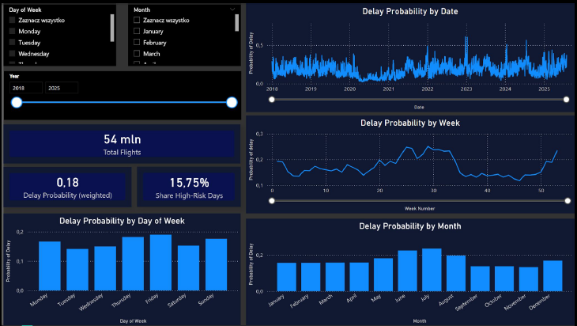

# Big Data Flight Delays Analysis

## Project Overview
This project demonstrates an end-to-end Big Data engineering and analytics pipeline. The objective was to process and analyze a large-scale dataset of US flight delays (approx. 7GB, 91 monthly files) to identify delay patterns, calculate probabilities, and highlight high-risk travel days.

## Architecture & Technology Stack
The pipeline follows the **Medallion Architecture** (Bronze, Silver, Gold) and is built using:
* **Apache Spark (PySpark) & Databricks:** For scalable data processing and ETL operations.
* **Delta Lake:** For reliable and optimized storage at each architectural layer.
* **Power BI:** For building an interactive dashboard and data model based on the aggregated Gold layer.

## Pipeline Structure
1. **[Bronze Layer](./notebooks/01_bronze_ingestion_3.py):** Raw data ingestion. Data is loaded from CSV files into Delta tables with added metadata (`_source_file`, `_ingestion_ts`) for reproducibility.
2. **[Silver Layer](./notebooks/02_silver_transformation_3.py):** Data cleaning and structuring. This step involves type casting, parsing dates/times, and filtering invalid data (e.g., removing cancelled flights for delay analysis).
3. **[Gold Layer](./notebooks/03_gold_analysis_3.py):** Business-level aggregations. The data is grouped to calculate flight volumes and delay probabilities across different dimensions:
   * By hour of the day
   * By day of the week
   * By origin airport
   * By specific dates (flagging high-risk days where the delay probability is in the top 15%).
   
These aggregated tables were exported as CSVs to feed the BI model.

## Dashboard
The final step of the project involved designing a relational data model (connecting dimension tables like `DimDate` and `DimHour` with fact tables) and creating a Power BI dashboard to visualize the insights.

## Key Insights
* The analysis successfully identified temporal patterns in flight delays (e.g., specific hours or days of the week with higher delay probabilities).
* Although based on US data, the analytical patterns and seasonality (e.g., summer peaks, major holidays) can be interpreted and applied globally.

## Authors
* Izabela Kosiec
* Katarzyna Pełka